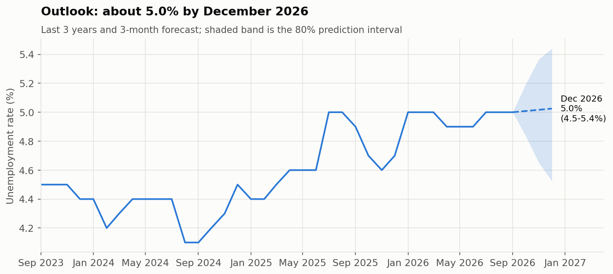

# Irish Unemployment: Trends and a 3-Month Outlook

An automated, reproducible statistical release built on **CSO open data** (table MUM01,
seasonally adjusted monthly unemployment, January 1998 onwards), with a short-term forecast
whose accuracy is tested honestly.

**[Read the report →](https://bymankirat.github.io/ireland-unemployment-outlook/)**



> Independent analysis using CSO data. Not an official CSO publication.

## What it does

1. **Downloads** the latest MUM01 table straight from the CSO's open data API (PxStat). No manual steps.
2. **Summarises** the latest month like a release: rate and number unemployed by age and sex,
   with changes on the month and on the year.
3. **Analyses** the long-run trend since 1998, youth unemployment relative to adults, and the gender gap.
4. **Forecasts** the unemployment rate 1-3 months ahead with four transparent models:
   no change, 12-month drift, AR(2) on monthly changes, and damped-trend exponential smoothing.
5. **Tests the forecasts honestly** with a rolling-origin backtest: every month, each model sees only
   the data available then. The model is chosen on 2012-2019 (COVID-19 months excluded) and judged
   once on 2022 onwards.
6. **Checks the uncertainty:** 80% prediction intervals are built from past errors, and the report
   shows how often they actually contained the outcome.
7. **Checks data quality first:** 10 automatic checks (all series present, no gaps or duplicates,
   plausible ranges, parts close to totals, sudden jumps, freshness) write a PASS/WARN/FAIL log to
   `reports/qc_log.txt`. Any FAIL stops the pipeline, so a broken download can never be published.
8. **Publishes** everything as one web page (`docs/index.html`), ready for GitHub Pages.

## Run it

```bash
pip install -r requirements.txt
python run_pipeline.py            # downloads the data and builds the report
python run_pipeline.py --refresh  # after the CSO's next monthly release
```

Outputs: `docs/index.html` (report), `reports/figures/` (charts), `reports/*.csv` (tables and backtest),
`reports/summary.md` (one-line summary).

## Why it is built this way

- **Benchmarks first.** A forecast only matters if it beats "no change". The report says so plainly
  when it does not.
- **No look-ahead.** Model choice and interval widths come only from the validation years.
- **Known limitation:** the CSO revises recent months as new Labour Force Survey results arrive. The
  backtest uses today's revised figures rather than the figures available at the time, so real-time
  accuracy would be somewhat lower.

## Project structure

```
run_pipeline.py        download -> analysis -> forecasts -> charts -> report
src/config.py          table, labels and forecast settings
src/data_loading.py    CSO PxStat download and tidying
src/analysis.py        headline table, long-run, youth and gender figures
src/quality.py         automatic data-quality checks and log
src/forecasting.py     models, rolling-origin backtest, empirical intervals
src/charts.py          figures
src/report.py          the release-style web page
```

Contains CSO data, licensed under CC BY 4.0. Mankirat Singh ·
[Portfolio](https://bymankirat.github.io/myportfolio/) · [LinkedIn](https://linkedin.com/in/mankirat-singh-694440177)
